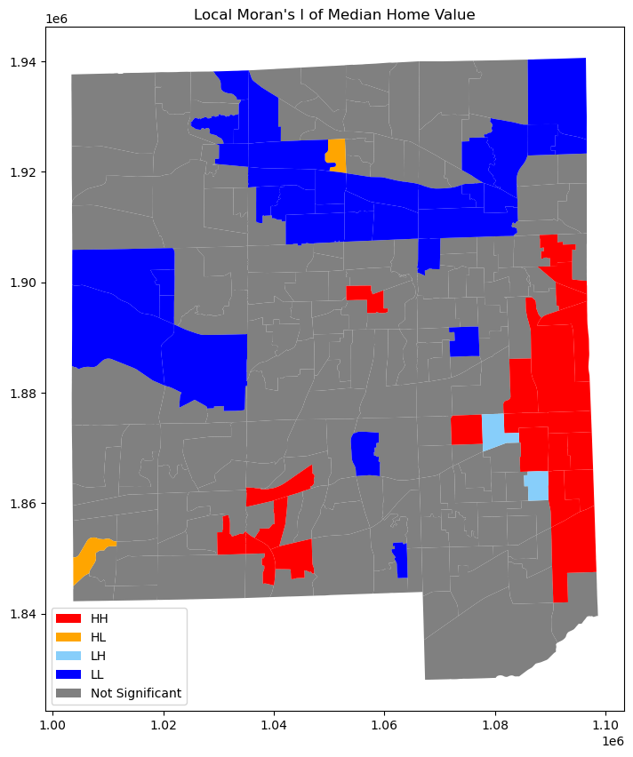
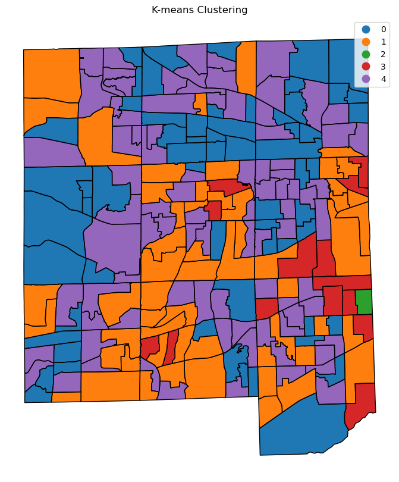

<a href="/" class="back-link">← Back to Home</a>

# Do Parks Raise Home Values?

  Python
  geopandas
  esda / libpysal
  scikit-learn (K-means)

This project tested whether census tracts in DuPage County, IL with more park area tend to have higher median home values than tracts with less park access — a question motivated by the idea that proximity to park resources could be reflected in local property values.

I combined three datasets: DuPage County census tract boundaries, a county parks shapefile, and 5-year (2020–2024) median home value estimates from the U.S. Census Bureau. I used a geometric overlay to intersect park polygons with census tracts, then summed park acreage by tract to get total park area per tract. 

  
  
Local Moran's I map of DuPage County census tracts by home value

To test for spatial clustering in home values, I built a queen's contiguity spatial weights matrix and ran a Local Moran's I with 99 permutations to identify statistically significant high- and low-value clusters. Then, I ran K-means clustering (k=5) on park area and median home value together to see whether tracts naturally grouped by both variables at once.

  
  
K-means clustering (k=5) of census tracts by total park area and median home value.

The analysis found that median home values exhibit spatial clustering across DuPage County, but K-means clustering did not indicate that total park area was a strong factor associated with home values. I concluded that additional research at finer geographic scales, such as examining properties and streets near parks, could help reveal more localized relationships. Other factors, including school district quality and population density, may also help explain differences in home values.

