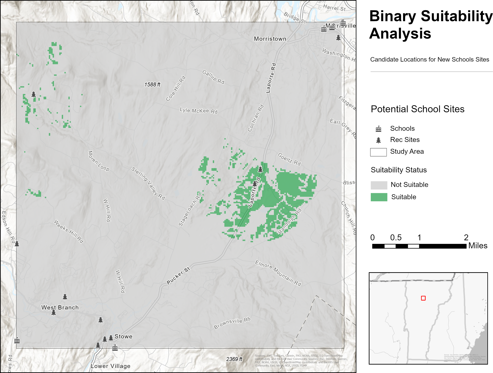
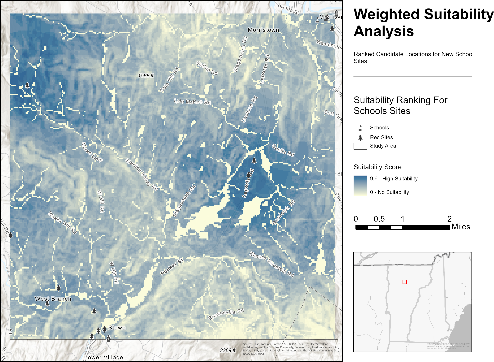

<a href="/" class="back-link">← Back to Home</a>

# School Site Suitability Analysis

  ArcGIS Pro
  Euclidean Distance
  Reclassify
  Weighted Overlay

This project explored potential locations for a new school by comparing two GIS suitability models to answer a planning question: where does the study area offer the most suitable land for school development?

I used ArcGIS Pro to develop two raster-based suitability models using school and recreation site locations, elevation data, and land-use constraints. The first model applied binary logic to identify land that met all specified criteria, including distance from existing schools, proximity to recreation sites, and slope.

  
  
Binary suitability model — land meeting every threshold for distance from schools, proximity to recreation sites, and slope.

The second model used the Reclassify and Weighted Sum tools to score locations on a 1–10 suitability scale, assigning equal weights to distance from schools, proximity to recreation sites, and slope.

  
  
Weighted suitability model — every cell scored 1–10 based on combined criteria.

Both models identified promising locations in the eastern portion of the study area near two recreation sites, with additional candidate areas in the northwest. Comparing the results highlighted the trade-offs between the two approaches: binary logic clearly identifies locations that meet every requirement but excludes sites that fall just outside a threshold, while weighted suitability captures a broader range of potential sites but can give similar scores to locations with different strengths and weaknesses. I concluded that using both models together could help planners identify stronger candidates for a new school than either model alone.

