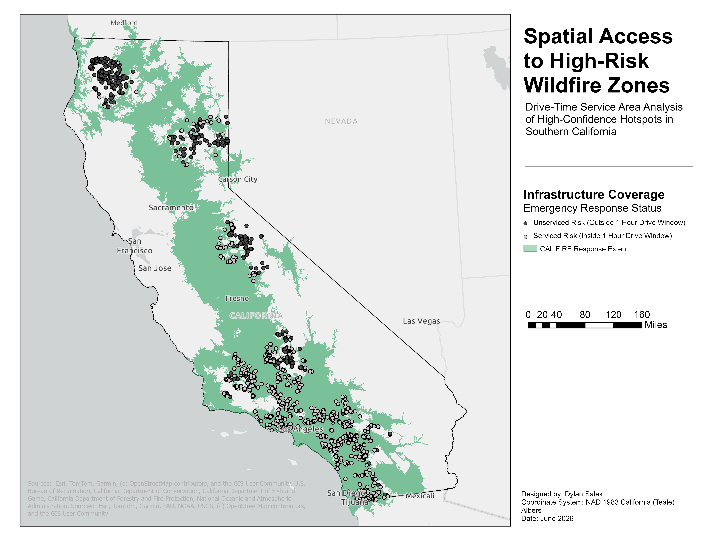

<a href="/" class="back-link">← Back to Home</a>

# Wildland Fire Risk & Response Coverage

  ArcGIS Pro
  Kernel Density Estimation
  Optimized Hot Spot Analysis
  Network Analyst (Service Area)

This project explored the spatial patterns of California's wildland fires to answer two questions: where are the state's high-risk wildfire zones, and are CAL FIRE facilities positioned to respond to them?

I sourced wildfire perimeter data from the Wildland Fire Interagency Geospatial Services portal and CAL FIRE facility data from the SCAG open data portal. To identify high-risk zones, I ran a Kernel Density Estimation and an Optimized Hot Spot Analysis to detect statistically significant clusters of historic wildfire activity.

  
  
Kernel density estimation showing the concentration of historic wildfire activity across California.

I then used Network Analyst's Service Area tool to test whether CAL FIRE facilities could reach those high-risk zones within a 1-hour drive, comparing the resulting service area polygon against random points weighted by each fire's acreage to account for variation in real-world response distances.

  
  
CAL FIRE's 1-hour drive-time service area compared against modeled high-risk points.

The analysis identified high-risk wildfire zones in Central California near Yosemite and Plumas County, and in far Northern California. The service area analysis found that 69% of modeled risk points fell within a 1-hour drive of a CAL FIRE facility. Most of the remaining 31% were in high-elevation or remote terrain, where aerial resources like air tankers and helicopters would likely lead the initial response instead of ground crews — leading me to conclude that CAL FIRE's facility network is well-positioned to handle the identified high-risk zones.

This analysis relies on historical wildfire data to estimate future risk, which assumes past patterns will hold as California's wildlands continue to change — a reasonable starting point, but not a guarantee. It's also worth noting that CAL FIRE operates within a broader response network of federal and local agencies, so these findings speak only to CAL FIRE's own ground infrastructure, not the full picture of wildfire response capacity in these zones.

